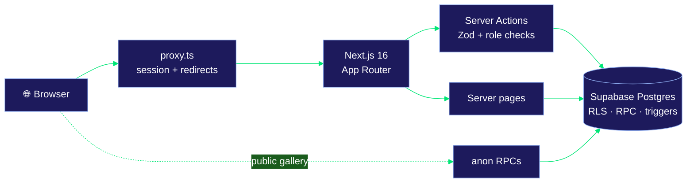

<div align="center">



<br />
<br />

[](https://nextjs.org/)
[](https://react.dev/)
[](https://www.typescriptlang.org/)
[](https://tailwindcss.com/)
[](https://supabase.com/)


**The official submission, judging and showcase platform for the Web Development Competition at MIT-WEEK 2026.**

[🛡️ Features](#%EF%B8%8F-three-portals-one-competition) · [🗺️ Journey](#%EF%B8%8F-the-competition-journey) · [🔒 Security](#-security-by-design) · [🎨 Design](#-the-guardian-design-system) · [🚀 Quick start](#-quick-start) · [📚 Docs](#-documentation)

</div>

---

## ⚡ About MIT-WEEK 2026

**MIT-WEEK (Mulawarman Informatics Technology Week) 2026** is the annual flagship tech event of the Association of Informatics, Faculty of Engineering, Mulawarman University: national seminars, hands-on workshops, and competitions across IT disciplines.

This repository is the **Web Development Competition** platform, themed **"Guardians of the Digital Space"**. It runs the contest end to end:

> 🧑‍💻 **Teams** submit their work, track their phase and receive anonymized feedback.<br />
> ⚖️ **Judges** score blind against a weighted rubric, round by round.<br />
> 🛡️ **The committee** controls deadlines, results, finalists and the public gallery.<br />
> 🌐 **Everyone** can browse the public gallery of works at `/karya`.

---

## 🗺️ The competition journey


The team dashboard follows this timeline automatically. A pure phase resolver (`open → closed → review → finalist / not-finalist → final → results`) picks the hero, the layout and the next milestone, using **server time in WITA**, never the device clock. See [Competition phases](docs/documentation/COMPETITION-PHASES.md).

---

## 🛡️ Three portals, one competition

<table>
<tr>
<td width="33%" valign="top">

### 🧑‍💻 Teams · `/team`

- **Phase-aware hero**: live countdown and link checklist while open; "TERKUNCI.", "Juri sedang menilai" with days-to-Top-5, and finalist / final / results states afterwards
- **Guardian ID card**: hex-badge access pass with team code and roster
- **Journey track**: hex nodes with "HARI INI" on the line
- **Draft → submit → update** workflow with server-side link checks
- **Ticket receipt**: stamped, copyable, prints as a plain receipt
- **Showcase editor** (`/team/karya`): drag-and-drop 16:10 image, live gallery preview
- **Case study** with reading progress and a deliverables checklist ticked from the real submission
- **Results** (`/team/hasil`): weighted totals and anonymous feedback, once released

</td>
<td width="33%" valign="top">

### ⚖️ Judges · `/judge`

- **Queue** filtered by stage and status (Belum dinilai, Draf, Terkunci)
- **Blind scoring**: peers' scorecards stay invisible
- **Rubric forms** with a live weighted preview (two decimals)
- **Draft or lock** each scorecard, with confirmation
- **Recusals** for conflicts of interest
- **Auto read-only** once results are released, enforced by database triggers
- **Case study** reference in the portal

</td>
<td width="33%" valign="top">

### 🛡️ Committee · `/admin`

- **Dashboard**: KPIs, countdown, phase timeline, judging progress
- **Accounts & teams**: provisioning, activation, disqualification
- **Finalists**: Top 5 selection and finalist notices
- **Submissions**: monitoring, overrides, CSV export
- **Rankings**: live views and CSV export
- **Pengaturan**, split into sections: deadline, results release, two-stage gallery publishing, case study, links & contact
- **Audit log** of sensitive actions

</td>
</tr>
</table>

### 🌐 Public gallery · `/karya`

A no-login showcase of every team that opted in, opened in two stages (gallery + finalists, then winners with a podium). It is served only through anon-callable `SECURITY DEFINER` functions, so the public never touches a table.

---

## 🔒 Security by design

| Layer | Guarantee |
| :-- | :-- |
| 🧱 **Row Level Security** | Every table has RLS and explicit grants. `anon` gets **nothing** on tables, views or sequences. |
| 🪪 **Roles** | Read only from `profiles` (active accounts only), never from JWT claims or client input. |
| 🎯 **No IDOR** | Team and judge IDs come from the session (`auth.uid()`), never from request payloads. |
| 🕶️ **Anonymous results** | Teams read scores only through `get_my_results()`: aggregates and shuffled comments, no judge identity, timestamps, rank or raw peer scores. |
| 🔐 **Score locks** | Triggers block `INSERT`/`UPDATE`/`DELETE` on scores once a stage is released. |
| 🧪 **Link checks** | Server-side URL validation with an SSRF guard (DNS resolution, private-IP blocking). |
| 📊 **Safe exports** | Admin-only CSV with BOM, formula-injection neutralization (`= + - @ \t \r`) and `no-store`. |
| 🔗 **Safe links** | Only `http`/`https` render as links, always `target="_blank" rel="noopener noreferrer"`. |
| 🗝️ **Secrets** | The service-role key is server-only (`server-only` module), never in `NEXT_PUBLIC_*` or logs. |

Full model: [Data model & security](docs/documentation/DATA-MODEL.md).

---

## 🎨 The Guardian design system


Navy ink outlines, neon-mint accents, hex shapes and hard offset shadows, with one rule to keep it from getting noisy:

| 🔊 **Loud** | 🤫 **Calm** |
| :-- | :-- |
| Hero, Guardian ID, receipt ticket, journey track, active nav | Forms, settings, tables, help strip |
| `border-2 border-ink` + `shadow-brutal` + big display type | thin border, soft shadow, regular type |

Buttons **press** (they sink 2px into their shadow). Every animation respects `prefers-reduced-motion`. Light and dark mode both ship, with one shared light/dark toggle. Read the [Design system](docs/documentation/DESIGN-SYSTEM.md).

---

## 🏗️ Architecture



A single Next.js monolith: no separate backend, queue or cache. PostgreSQL RLS, `SECURITY DEFINER` functions with an empty `search_path`, and triggers are the security boundary; UI guards are convenience. See [Architecture](docs/documentation/ARCHITECTURE.md).

<details>
<summary><b>📂 Project structure</b></summary>

```text
web-submissions/
├── docs/
│   ├── assets/                       # README banner
│   ├── documentation/                # Setup, architecture, data, design system, phases, settings, ops
│   └── development/                  # Phase-specific implementation specs
├── src/
│   ├── proxy.ts                      # Session refresh & redirects (/login and /karya are public)
│   ├── app/
│   │   ├── (auth)/login/             # Sign-in
│   │   ├── karya/                    # Public gallery
│   │   ├── globals.css               # Theme + Guardian tokens and utilities
│   │   └── (main)/
│   │       ├── admin/                # Dashboard, akun, audit, finalis, peringkat, submission, tim
│   │       │   └── pengaturan/       # Settings: pengumpulan, hasil, galeri, studi-kasus, tautan
│   │       ├── dashboard/_components # Shared shell, Guardian sidebar, user chip
│   │       ├── judge/                # Queue, nilai/[tahap]/[teamId], studi-kasus
│   │       └── team/                 # Phase hero, journey track, ID card, receipt, karya, hasil, studi-kasus
│   ├── components/                   # Shared UI (theme-toggle, showcase-card, …); ui/ = shadcn (untouched)
│   ├── lib/                          # auth, deadline (WITA), rubric, csv, link-check, audit, supabase clients
│   ├── navigation/sidebar/           # Role-based sidebar registry
│   └── types/database.ts             # Generated Supabase types
├── supabase/migrations/              # Schema, RLS, RPCs, views, triggers (source of truth)
├── scripts/                          # Backup, restore, onboarding, showcase seed, WhatsApp links
└── tests/                            # Vitest unit tests (deadline, rubric)
```

Every file's job is mapped in [MAP.md](docs/documentation/MAP.md).

</details>

---

## 🧰 Tech stack

| Layer | Technology |
| :-- | :-- |
| **Framework** | Next.js 16 (App Router, Turbopack), React 19, TypeScript 5.9 (strict) |
| **Styling** | Tailwind CSS v4, shadcn/ui (radix-nova), Lucide icons |
| **Backend** | Supabase: PostgreSQL, Auth, RLS, RPC functions, Storage |
| **Forms & validation** | React Hook Form, Zod |
| **Tables** | TanStack Table v9 |
| **Quality** | Biome (lint + format), Vitest, Husky + lint-staged, GitHub Actions CI |

---

## 🚀 Quick start

**Prerequisites:** Node.js 20+, npm 10+, a Supabase project (local or cloud).

```bash
git clone https://github.com/TromBoloN/web-submissions.git
cd web-submissions
npm install
```

Create **`.env.local`** (never commit it; the service-role key never goes in `.env`):

```env
NEXT_PUBLIC_SUPABASE_URL=https://your-project.supabase.co
NEXT_PUBLIC_SUPABASE_PUBLISHABLE_KEY=your-publishable-key
SUPABASE_SERVICE_ROLE_KEY=your-service-role-key   # server-only
```

Apply every file in `supabase/migrations/` **in filename order** (Supabase CLI or SQL editor), then start:

```bash
npm run dev   # http://localhost:3000
```

<details>
<summary><b>🗄️ Migration list</b></summary>

| Migration | Adds |
| :-- | :-- |
| `20261020000000_init_schema` | Core schema, RLS, helper functions, ranking views |
| `20261024000000_contestant_features` | Juknis link, case study, receipts & link checks, finalist notice |
| `20261025000000_judging_and_contact` | Notes for judges, append-only submission history, score locking, public WhatsApp contact |
| `20261026000000_team_results` | Release flags and the `get_my_results()` RPC |
| `20261027000000_score_release_lock` | Score freeze triggers after release |
| `20261108000000_fix_first_submitted_at` | First-submit timestamp fix |
| `20261108010000_drafts_recusals_and_private_notes` | Score drafts, recusals, judge private notes |
| `20261108020000_audit_logs` | Audit log table |
| `20261109000000_showcase` | Showcase consent/details, gallery publishing, public gallery RPCs, `web-showcase` bucket |
| `20261109010000_showcase_winners` | Winners publishing and public winners RPC |
| `20261110000000_fix_showcase_phase_one` | Gallery publishing fix |
| `20261114000000_competition_stages` 🆕 | Schedule as data (`competition_stages`) · **pending review** |
| `20261114010000_event_identity_and_final_details` 🆕 | Event identity, finalist count, final presentation details · **pending review** |

After applying any migration, regenerate `src/types/database.ts` as **UTF-8**.

</details>

Full guide with troubleshooting: [Setup](docs/documentation/SETUP.md).

---

## 📜 Scripts

| Command | Purpose |
| :-- | :-- |
| `npm run dev` | Development server (Turbopack) |
| `npm run build` / `npm start` | Production build (with type-check) / serve it |
| `npm run lint` · `npm run check` · `npm run check:fix` | Biome lint · lint + format check · auto-fix |
| `npm run format` | Biome format |
| `npm test` | Vitest unit tests |
| `npm run backup` / `npm run restore` | JSON backup to `private-output/` / restore from it (see [Operations](docs/documentation/OPERATIONS.md)) |
| `npm run seed` / `npm run seed:clear` | Seed or clear demo accounts (`@seed.mitweek.test`). ⚠️ **Never against production.** |
| `npm run seed:showcase` | Demo showcase data: `-- seed`, `-- seed --publish`, `-- clear` |
| `npm run onboard` | Import registered teams: dry run by default; `-- --commit` creates accounts and writes credentials to `private-output/` |
| `npm run whatsapp` | Local helper page for sending team portal credentials via WhatsApp (newest `private-output/credentials-*.csv`) |

---

## 📚 Documentation

| 🧭 I want to… | 📖 Read |
| :-- | :-- |
| Run it locally | [Setup](docs/documentation/SETUP.md) |
| Find where something lives | [MAP.md](docs/documentation/MAP.md) |
| Understand the system | [Architecture](docs/documentation/ARCHITECTURE.md) |
| Understand tables, RPCs, RLS | [Data model & security](docs/documentation/DATA-MODEL.md) |
| Understand team phases & dates | [Competition phases](docs/documentation/COMPETITION-PHASES.md) |
| Work on admin settings | [Admin settings](docs/documentation/ADMIN-SETTINGS.md) |
| Style a screen | [Design system](docs/documentation/DESIGN-SYSTEM.md) · [Frontend conventions](docs/documentation/FRONTEND.md) |
| Find routes & server interfaces | [Application reference](docs/documentation/API.md) |
| Deploy, back up, handle incidents | [Operations](docs/documentation/OPERATIONS.md) |
| Contribute | [Contributing](docs/documentation/CONTRIBUTING.md) |

🤖 **AI agents:** start with [AGENTS.md](AGENTS.md) (rules) and [AI.md](AI.md) (current state and open decisions: ask, never decide).

---

<div align="center">

**Built for MIT-WEEK 2026 · Web Development Competition**


</div>
