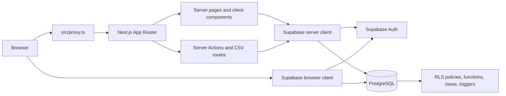

# Architecture

## System shape

The project is a Next.js 16 App Router application. Browser requests reach Next.js, which uses Supabase's browser or server client depending on the operation. PostgreSQL RLS and database functions remain the security boundary.



There is no application cache, queue, worker, or third-party payment/integration service in this repository. External URLs are participant-submitted links to GitHub, deployed demos, and videos; the application validates and displays them but does not proxy those services.

## Request and file conventions

Most screens use the adjacent-file convention:

```text
route/
  page.tsx       server component: fetches data and composes the screen
  *-client.tsx   client component: interaction and browser state
  actions.ts     server actions: validate input, authenticate, authorize, mutate
  queries.ts     server-side read helpers where needed
```

Route groups `(auth)` and `(main)` do not appear in URLs. `(main)` contains the protected dashboard shell. `src/proxy.ts` refreshes the session and redirects unauthenticated users; route layouts provide UX guards, but data access must still be protected by RLS and server authorization.

## Key user flows

### Team submission

1. A team signs in through `/login`.
2. `src/lib/auth.ts` reads the authenticated user with `getUser()` and loads the active `profiles` row.
3. The team page reads its own team and submission through the server Supabase client.
4. The team server action validates links and submission state, then writes through RLS.
5. `team_can_submit` and database constraints enforce ownership, deadline, disqualification, and required URLs.
6. The page renders draft/submitted status and server-derived deadline information in WITA.

### Judge scoring and release

1. A judge opens `/judge` and sees only eligible assigned teams.
2. The scoring page loads the judge's permitted stage and submission.
3. The judge saves a draft or locks a score through a server action.
4. `judge_can_score_preliminary` or `judge_can_score_final`, plus RLS and release-lock triggers, enforce the write boundary.
5. An admin changes the stage release flag in `/admin/pengaturan`.
6. The `get_my_results()` security-definer function exposes only released, authorized aggregates and anonymized feedback to the owning team.

## Authentication and authorization

- Supabase Auth supplies the identity and session.
- `profiles.role` is the only application role source; do not use user metadata, JWT claims, or client input for roles.
- `requireRole()` protects pages for user experience. Server actions and export routes perform their own authentication/authorization.
- `admin` manages accounts, teams, settings, finalists, rankings, and exports.
- `judge` sees assigned stages and scores eligible submissions.
- `team` manages its own submission and sees only its released results.
- RLS, security-definer functions with an empty `search_path`, and database constraints/triggers enforce the actual boundary.

## Design decisions

- **Supabase client split:** browser and cookie-based server clients preserve the user's RLS context; the admin client is server-only and bypasses RLS only for explicitly administrative workflows.
- **Database-calculated totals:** score totals are generated in PostgreSQL and mirrored by `src/lib/rubric.ts` for the live UI preview. Change both only when the rubric is intentionally changed.
- **Exclusive deadline:** the database stores the first instant that is no longer accepted; the UI presents the previous minute as the last accepted WITA minute.
- **Released results RPC:** teams do not receive direct score-table access. The RPC derives the caller's team from `auth.uid()` and strips judge identity and unreleased data.
