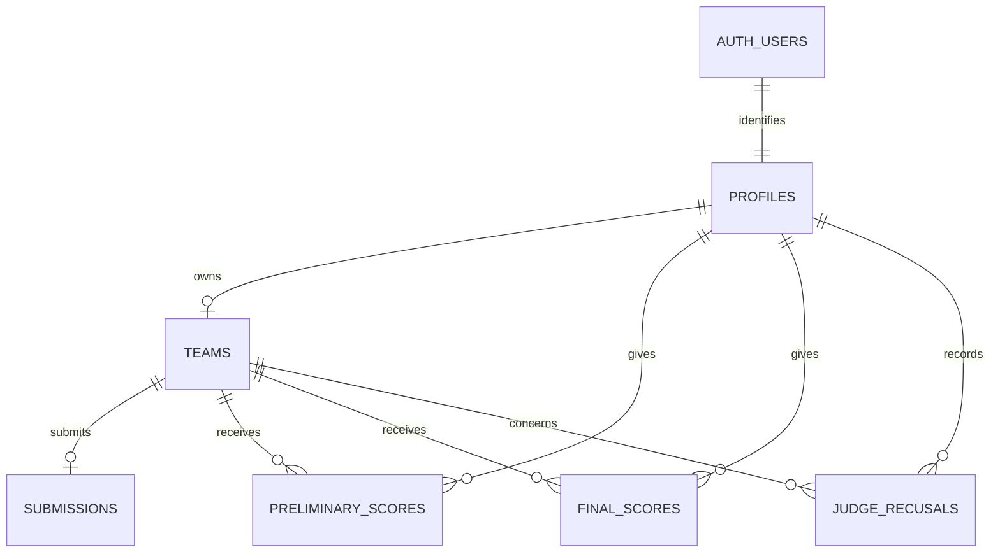

# Data model and security

## Entity relationship overview

## Core tables

| Table/view | Purpose |
| --- | --- |
| `profiles` | Application profile, role, judge-stage assignment, and active status linked to `auth.users`. |
| `teams` | Team identity, roster, finalist flag, and disqualification state. |
| `competition_settings` | The single competition settings row, deadline, guidebook URL, and release flags. |
| `submissions` | One draft or submitted set of GitHub, live-demo, and video links per team. |
| `case_study` | The single Markdown case-study row, release time, and last updater. |
| `preliminary_scores` | One score per preliminary judge/team pair, with generated weighted total and feedback. |
| `final_scores` | One score per final judge/team pair, with generated weighted total and feedback. |
| `judge_recusals` | Judge/team recusal records used to exclude conflicted assignments. |
| `preliminary_ranking` | Aggregate preliminary ranking view. |
| `final_ranking` | Aggregate final ranking view. |

Additional case-study and contact fields are introduced by later migrations; inspect the migration and generated database types before changing them.

## Scoring

The current rubric is defined in both the generated score columns and [rubric.ts](../../src/lib/rubric.ts):

| Criterion | Preliminary | Final |
| --- | ---: | ---: |
| Fungsionalitas | 35% | 25% |
| Kesesuaian dengan Studi Kasus | 25% | 20% |
| UI/UX | 20% | 15% |
| Kualitas Kode & Pemeliharaan | 10% | 10% |
| Dokumentasi | 10% | 10% |
| Presentasi dan Q&A | - | 20% |

Scores are bounded from 0 to 100 and totals are stored as generated numeric values rounded for display to two decimals.

## Security invariants

- All application tables have RLS and explicit grants; `anon` receives no application-table privileges.
- Server actions authenticate with `getUser()` and verify the profile role before touching data.
- Team and judge identifiers come from the authenticated session, never from client-provided IDs.
- Teams receive results only through `get_my_results()`, which checks active ownership and release state inside the function.
- Results expose aggregates and anonymous comments, not judge IDs, names, timestamps, rank, or per-judge raw scores.
- Release triggers block score inserts, updates, and deletes after a stage is released.
- Admin CSV routes independently return 401 for unauthenticated requests and 403 for non-admin users; exports use BOM, formula-neutralized cells, and `no-store`.

Treat these as invariants when adding a route, action, table, function, or export. If a change requires a schema modification, request approval and add a new migration rather than editing an applied migration.
