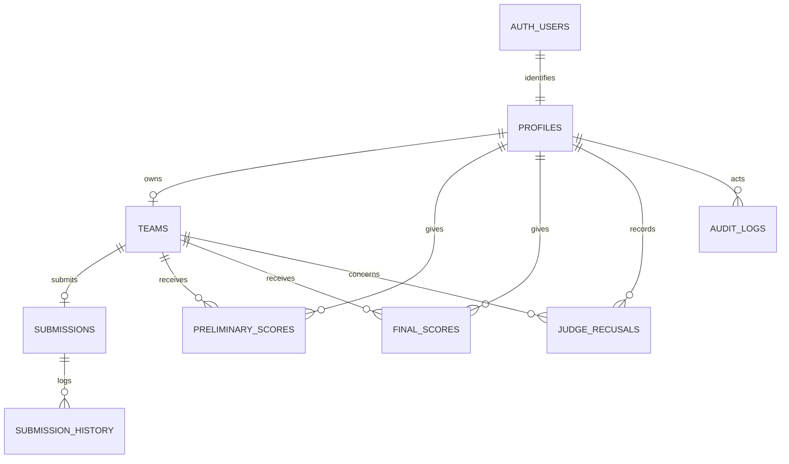

# Data model and security

`supabase/migrations/` is the source of truth. Applied migrations are never edited; schema changes go in a new migration, written only with the owner's approval. After applying, regenerate `src/types/database.ts` (UTF-8; on PowerShell 5.1 use `| Out-File -Encoding utf8`, never `>`).

## Entity relationship overview

Single-row tables (`id BOOLEAN PRIMARY KEY CHECK (id)`): `competition_settings`, `case_study`, `finalist_notice` and, once applied, `final_presentation`.

## Tables

| Table/view | Purpose |
| --- | --- |
| `profiles` | Role (`admin`/`judge`/`team`), judge stage (`preliminary`/`final`/`both`), `is_active`, linked to `auth.users`. The only source of roles. |
| `teams` | Team code, name, institution, leader, members, `is_finalist`, `is_disqualified`, showcase consent/title/description/image path, `showcase_is_finalist` snapshot. |
| `competition_settings` | Deadline (`submission_closes_at`, exclusive), `juknis_url`, `contact_whatsapp`, result-release flags, showcase/winners publication timestamps, `showcase_consent_locked_at`. |
| `submissions` | One draft or submitted set of GitHub, live-demo and video links per team, notes for judges, link-check result, `first_submitted_at`. |
| `submission_history` | Trigger-written history of submission changes (`log_submission_change`). |
| `case_study` | Markdown case study, optional `release_at`, last updater. |
| `finalist_notice` | Finalist and non-finalist messages, `is_published`, `published_at`. Admin-only; teams read via `get_my_finalist_notice()`. |
| `preliminary_scores`, `final_scores` | One score per judge/team pair, generated weighted total, feedback, draft/final status. |
| `judge_recusals` | Judge/team/stage conflicts excluded from assignments and progress. |
| `audit_logs` | Sensitive admin/judging actions, written server-side by `logAuditEvent()` with the service role; admin-only SELECT. |
| `preliminary_ranking`, `final_ranking` | Aggregate ranking views (`security_invoker`). |

Storage: bucket `web-showcase` holds team showcase images (`showcase/<profile_id>/<uuid>.<ext>`), cropped to 16:10 client-side before upload.

## Database functions

All are `SECURITY DEFINER` with an empty `search_path` unless noted, and check authorization inside the body.

| Function | Callable by | Purpose |
| --- | --- | --- |
| `current_user_role()`, `current_user_judge_stage()` | internal / policies | Role and stage of the caller's **active** profile |
| `submission_open()`, `team_can_submit()` | internal / policies | Deadline and ownership checks for submissions |
| `judge_can_view_team()`, `judge_can_score_preliminary()`, `judge_can_score_final()` | internal / policies | Judge assignment and stage checks |
| `get_my_results()` | authenticated (team) | Released, anonymized aggregates and feedback for the caller's own team |
| `get_my_finalist_notice()` | authenticated (team) | Finalist or non-finalist message once published; nothing for disqualified teams |
| `set_showcase_consent()`, `save_showcase_details()` | authenticated (team) | Team edits its own showcase while unlocked |
| `publish_showcase_phase_one()`, `publish_showcase_phase_two()`, `publish_showcase_winners()` | authenticated (admin check inside) | Gallery publication stages |
| `get_public_showcase()`, `get_public_showcase_winners()` | **anon** | Public gallery data (consenting teams only) |
| `get_public_contact_whatsapp()` | **anon** | Committee WhatsApp number for the login page |
| Trigger functions (`touch_updated_at`, `lock_score_keys`, `check_*`, `log_submission_change`, `set_submission_*`) | not client-callable | Timestamps, score locks after release, recusal checks, history |

Anon access is only ever granted on functions that return public fields. `anon` has no privileges on any table, view or sequence.

## Pending migrations

Written, **not applied** at the time of writing. Check `src/types/database.ts` for `competition_stages`: if it is missing, they have not been applied.

### `20261114000000_competition_stages.sql`

- `competition_stages`: one row per milestone (`key`, `title`, `description`, `starts_on`/`ends_on` as WITA `DATE`, `time_label`, `sort_order`, `show_on_track`, `status_override` (`NULL`/`upcoming`/`current`/`done`), `is_system`, `updated_at`, `updated_by`).
- Seeded system stages: `review`, `top5`, `gallery` (hidden from the track), `final`, `winners`. The submission deadline stays in `competition_settings`.
- Trigger `guard_competition_stage` blocks changing a system key or `is_system` and stamps `updated_by`. RLS: any active role reads; admin writes; system rows cannot be deleted; admins cannot create system rows.
- `get_public_competition_schedule()`: anon + authenticated, schedule fields only.

### `20261114010000_event_identity_and_final_details.sql`

- `competition_settings` gains `event_name`, `event_track`, `finalist_count` (1–20, display only; finalists are still picked manually) and `gallery_new_badge_days` (0–60).
- `get_public_event_info()`: anon + authenticated, identity fields only.
- `final_presentation` (single row, admin-only RLS): `presentation_minutes`, `qa_minutes`, `venue`, `meeting_url` (https), `note`, `logistics_published`. It is a separate table because every signed-in role can read `competition_settings`.
- `get_my_final_presentation()`: returns data only to admins, judges with stage `final`/`both`, and non-disqualified finalist teams after the finalist notice is published. Venue and link are `NULL` until `logistics_published`.

After applying: regenerate types, then switch the hardcoded schedule listed in [Competition phases](./COMPETITION-PHASES.md) to these tables.

## Scoring

The current rubric is defined in both the generated score columns and [rubric.ts](../../src/lib/rubric.ts):

| Criterion | Preliminary | Final |
| --- | ---: | ---: |
| Fungsionalitas | 35% | 25% |
| Kesesuaian dengan Studi Kasus | 25% | 20% |
| UI/UX | 20% | 15% |
| Kualitas Kode & Pemeliharaan | 10% | 10% |
| Dokumentasi | 10% | 10% |
| Presentasi dan Q&A | - | 20% |

Scores are bounded from 0 to 100. Totals are generated numeric values, displayed with two decimals. Rubric weights are intentionally **not** editable from settings; changing them after scoring starts would change finished scores.

## Security invariants

- All application tables have RLS and explicit grants; `anon` receives no application-table privileges.
- Server actions authenticate with `getUser()` and verify the profile role before touching data.
- Team and judge identifiers come from the authenticated session, never from client-provided IDs.
- Teams receive results only through `get_my_results()`, which checks active ownership and release state inside the function.
- Results expose aggregates and anonymous comments, not judge IDs, names, timestamps, rank, or per-judge raw scores.
- Release triggers block score inserts, updates, and deletes after a stage is released.
- Finalist-only data (final venue and meeting link) is not stored on tables every role can read.
- Admin CSV routes independently return 401 for unauthenticated requests and 403 for non-admin users; exports use BOM, formula-neutralized cells, and `no-store`.

Treat these as invariants when adding a route, action, table, function, or export.
